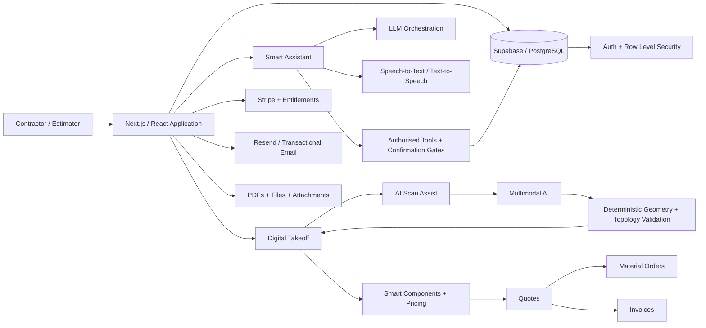

# QuoteCore+

**One builder. Production SaaS. Real customers. AI vision, conversational agents, construction geometry, pricing, quoting, orders, invoicing, billing, email and account infrastructure.**

QuoteCore+ is a production SaaS platform for roofing and construction businesses.

I independently conceived, designed, built, deployed and operate the product, using AI agents as my primary engineering force.

This repository is public partly as a technical portfolio: **QuoteCore+ is the proof of what I can deliver when given a real business problem, domain knowledge, the right tools and a desired outcome.**

## See it working

- **Interactive demo:** https://demo.quote-core.com/demo
- **Live application:** https://app.quote-core.com
- **Product website:** https://quote-core.com
- **Source:** https://github.com/algora-dev/quotecore-plus

The demo is the fastest way to understand the scope. This is not a portfolio mock-up or a collection of disconnected AI demos. It is commercial software with real users and customers.

---

## What I built

QuoteCore+ connects the core estimating and commercial workflow:

**Measure → Price → Quote → Send → Order → Invoice**

The platform includes:

- Digital PDF and image takeoff
- Roof, wall, cladding and flooring measurement
- Plan calibration and precision geometry
- Roof pitch and topology calculations
- **AI Scan Assist**
- **Smart Assistant**
- Reusable Smart Components™
- Material, labour, waste and margin calculations
- Construction pricing logic
- Customer and job management
- Quote generation and customer acceptance
- Material and purchase orders
- Invoicing
- Subscription billing
- Feature entitlements and usage limits
- Authentication and multi-tenant accounts
- Transactional email
- Document and attachment handling
- PDF generation
- Supplier and catalogue workflows
- Multi-currency and tax handling
- Responsive desktop, tablet and mobile workflows
- Public construction tools and calculators
- Automated E2E and domain-specific testing

The important part is not the number of features. It is that they operate as **one connected system**, carrying information from the first measurement through to the final commercial document rather than making the user rebuild the same job in multiple tools.

---

# AI systems

AI in QuoteCore+ is not limited to using AI to write the application. AI is also engineered directly into the product.

## AI Scan Assist

AI Scan Assist converts architectural roof plans into editable roof geometry.

It is deliberately not a single “upload image → trust model output” call. The architecture separates the problem into stages:

1. **Outline detection** — a multimodal model identifies the roof perimeter.
2. **Human correction** — the detected outline is exposed to the user for review before later stages rely on it.
3. **Internal geometry detection** — the system identifies visible internal roof lines from the corrected geometry.
4. **Classification** — detected lines are classified into roofing elements such as ridges, hips, valleys, barges and spouting.
5. **Deterministic validation and post-processing** — conventional code checks, cleans and reconciles probabilistic model output.

The deterministic layer includes work around:

- Structured model output
- Polygon validation
- Self-intersection detection
- Coordinate bounds
- Duplicate and zero-length edge removal
- Angle snapping
- Calibration-aware tolerances
- Endpoint and vertex matching
- Hip/valley geometry rules
- Corner completeness
- Perimeter accounting
- Topology completion
- Collinear merge handling
- Micro-cluster/island removal
- Confidence and uncertain-result handling
- Debug/audit overlays
- Usage and cost metering

The design principle is simple:

> **AI proposes geometry. Deterministic systems and the user decide whether it is trustworthy enough to use.**

This matters because these measurements ultimately affect quantities, pricing and real construction work.

---

## Smart Assistant

Smart Assistant is a conversational interface to QuoteCore+.

Instead of requiring the user to understand every screen and navigation path, it allows them to begin with the outcome they want. Users can interact using **text or voice**.

The system can work with authorised QuoteCore+ context to retrieve information, prepare work and propose supported changes.

It is not designed as an unrestricted chatbot with database access. Its architecture includes:

- Authenticated, company-scoped access
- Row-level-security-scoped reads
- Bounded tool/action authority
- Database-backed run state
- Atomic run admission and completion
- Idempotent request handling
- Duplicate-run protection
- Stale-run recovery
- Usage and quota enforcement
- Token/cost accounting
- Server-side trusted finalisation
- Proposal/confirmation workflows
- Proof/version checks on confirmed actions
- Workspace-change protection
- Allowlisted navigation targets
- Voice-to-text transcription
- Neural text-to-speech
- Streaming responses with controlled fallback behaviour
- Explicit user review before important commercial changes

The philosophy is deliberate:

> **The model can understand intent and accelerate the work. It does not automatically inherit authority.**

---

# Human-directed AI engineering

I did not build QuoteCore+ by manually typing every line of code. That is not the capability this repository is intended to demonstrate.

I use AI agents as an engineering force multiplier.

My job is to understand the problem, define what should exist, direct implementation, inspect what agents produce, recognise failures, maintain architectural coherence, test important boundaries and take responsibility for the production result.

A typical cycle looks like:

**Problem → domain understanding → specification → architecture → agent implementation → review → test → diagnose → correct → integrate → regression test → deploy → observe → iterate**

AI dramatically increases implementation velocity. It does not remove the need for judgment.

The difficult part of building large systems with agents is preventing thousands of individually plausible decisions from becoming one incoherent system.

That requires knowing:

- what should be deterministic and what can be probabilistic;
- where trust boundaries belong;
- what data an agent should be allowed to access;
- what actions require confirmation;
- whether a generated implementation really satisfies the requirement;
- whether a local fix damages another workflow;
- when an abstraction is useful versus unnecessary complexity;
- where security, billing and tenancy boundaries can fail;
- what needs automated regression protection;
- and when the right answer is to remove or rebuild something rather than continue adding code.

---

# Selected engineering problems

## 1. Turning visual plans into usable construction geometry

A roof plan is visual information. Pricing requires structured geometry.

QuoteCore+ bridges those worlds using multimodal AI, user review and deterministic computational geometry so that a probabilistic first pass can become editable data suitable for downstream calculations.

## 2. Keeping AI away from authority it should not have

AI is valuable for interpretation, extraction, intent and acceleration. It should not silently invent commercial truth.

QuoteCore+ separates AI reasoning from deterministic calculations, permission checks, account boundaries and confirmed commercial actions.

## 3. Reusable construction pricing logic

Smart Components™ encode repeatable business rules around materials, labour, coverage, pack sizes, waste, margin and measurement behaviour.

A measurement can therefore become material quantities and priced work without rebuilding the calculation on every job.

## 4. Maintaining one workflow across an entire job

QuoteCore+ connects:

**Takeoff → Pricing → Quote → Acceptance → Material Order → Job → Invoice**

The engineering challenge is maintaining valid business state and permissions as the same underlying job moves between different parts of the application.

## 5. Building commercial SaaS infrastructure around the product

Real AI products still need reliable conventional software underneath them. QuoteCore+ includes multi-tenant authentication, subscription billing, feature entitlements, AI-cost metering, transactional email, files/documents, customer-facing links, PDF generation, security-sensitive account operations, demo environments, responsive interfaces, testing and regression protection.

---

# Architecture

---

# Technology

**Application:** Next.js · React · TypeScript · Tailwind CSS

**Data & platform:** Supabase · PostgreSQL · Row Level Security · Vercel

**AI:** OpenAI APIs · multimodal/vision workflows · structured model outputs · Model Context Protocol · voice transcription · neural text-to-speech · tool-using conversational systems

**Commercial infrastructure:** Stripe · Resend · subscription entitlements · usage metering

**Documents & visual systems:** Fabric.js · PDF.js · jsPDF · Sharp · CSV/catalogue processing

**Validation:** Playwright · TypeScript · ESLint · Zod · smoke/billing checks · security-sensitive E2E coverage · entitlement testing · public/mobile workflows · email testing · roof takeoff/calibration/topology/measurement tests · Smart Assistant test harness

---

# What this project demonstrates

QuoteCore+ is one example, not the boundary of what I work on.

> **Give me a sufficiently defined problem, access to the relevant domain knowledge and tools, and a desired outcome, and I can work backwards from that outcome to a production system.**

This project demonstrates my ability to:

- Enter complex problem spaces and learn quickly
- Understand real business workflows
- Translate domain knowledge into software
- Design products rather than only implement tickets
- Direct AI agents across large bodies of work
- Evaluate and correct generated implementations
- Build AI-native product functionality
- Combine probabilistic AI with deterministic systems
- Design human review and authority boundaries
- Debug across frontend, backend, database and infrastructure
- Integrate external APIs and commercial services
- Think about security, permissions and multi-tenancy
- Build testing around critical behaviour
- Maintain a large evolving codebase
- Deploy and operate production software
- Ship complete systems rather than stop at prototypes

---

# About the builder

For roughly the last five years I have worked as a **founder and technology entrepreneur**, building across software, Web3, blockchain, smart contracts, social/digital products, websites, games, automation and AI-driven development.

Before that, I spent approximately two decades in roofing and construction, including **project management and business management**, estimating, quoting, project delivery and operational problem-solving.

That combination shapes how I build.

I do not approach software as a sequence of tickets. I naturally look for the highest-leverage problem, the unnecessary cost, the slow manual process, the weak handoff or the opportunity with the strongest measurable return.

Whether I am building my own company or working inside someone else’s, my default question is:

> **What can we improve, automate, simplify or remove - and where will doing that create the greatest ROI?**

I understand technology, but I also understand that businesses do not buy code. They buy outcomes.

QuoteCore+ happened because I understood the operational problem well enough to determine what the software needed to accomplish, then used modern AI to make the engineering economically possible at a scope that would traditionally require a substantially larger team.

I am particularly interested in:

**Forward-Deployed AI · Applied AI · AI Product Engineering · AI Automation · Agentic Systems · AI-native Operations**

I work best where the starting point is not:

> “Here is a Jira ticket. Implement this function.”

but:

> **“Here is the problem. Here are the people who understand it. Here is what success needs to look like.”**

From there, I build.
