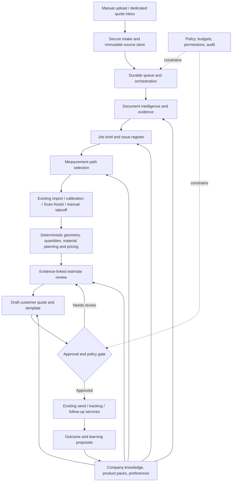

# QuoteCore+ AI Intelligence Architecture

**Version:** 0.2.1 — repository-grounded product and engineering specification  
**Date:** 2026-11-26  
**Status:** Revised after static review of supplied snapshot `e2209d3e6137748d66c589e6cdc8ad0aac487d76` (2026-11-24). Proposed implementation design, not a deployed feature or performance claim. Companion: `IMPLEMENTATION_PLAN.md`. Phase 1A status and constraints: `PHASE_1A.md`. Section 15 and companion plan govern repository-specific implementation decisions; runtime/schema verification and protected changes require authorized integration review.  
**Intended repository location:** `docs/architecture/ai-intelligence/ARCHITECTURE.md` (subject to current repository conventions).

## 1. Product mandate

QuoteCore+ must evolve from a manual estimating application with isolated AI features into a roofing business operating system with an optional, persistent, company-specific intelligence layer.

The target experience is that a roofing business receives a request for quotation, passes the available material to QuoteCore+, and the system progresses the job as far as it safely can without requiring someone to sit at the computer. It identifies the scope, relevant drawings and specifications; prepares or extracts measurements; applies the company's approved pricing; checks the estimate against the scope; prepares a customer-facing draft; and requests only the decisions and verification it genuinely needs. After approval it can use the existing sending, tracking and follow-up systems under explicit company policy.

**The human should primarily verify, decide and approve rather than repeat routine estimating work.** A person must remain able to inspect sources, make corrections, work manually and take control at any point.

### 1.1 Product modes, not two applications

Maintain one underlying application, shared data model, calculation engine and access-control system. Expose two principal account experiences:

- **Manual workspace:** Current workflows remain available without the new intelligence layer. Existing AI features may be invoked on demand where enabled.
- **Intelligent workspace:** An event-driven agent prepares work across the entire job lifecycle using approved knowledge, tools and policies. A review inbox becomes the primary entry point. Manual editors remain available everywhere.

Within Intelligent workspace, administrators can select assistance levels per capability: disabled, on-demand, proactive draft preparation, or approved policy-driven automation. Mode changes must be reversible without losing jobs or approved data. Switching off AI prevents new AI processing and stops or cancels queued agent work; independent existing non-AI schedules are managed separately and clearly disclosed. Previously sent communications cannot be undone.

There must not be a second fork of QuoteCore+ or a separate agent-owned copy of the pricing system.

### 1.2 North-star outcome

An established company with a validated pricing library and quoting profile can submit several jobs, including via a dedicated inbox, and return to a queue of substantially prepared estimates. The aspirational operating target is approximately twenty straightforward jobs reviewed within one hour, rather than a day of manual preparation. Complex, poorly documented or genuinely uncertain jobs will require more work. This is a performance hypothesis to measure against real roofing packages, not a guaranteed throughput, accuracy or completion time.

Optimize **total human time to a correct, approved quote**, not raw scan speed, token volume or the number of automated actions. Measure omissions, errors, rework, customer-facing quality, per-job cost and time-to-review together. Revenue and win-rate improvements are outcomes to investigate, not guaranteed results.

## 2. Non-negotiable architectural principles

1. **One source of truth.** Existing canonical job, customer, component, pricing, geometry, quote and message records remain authoritative. The agent proposes or acts through application services; it does not invent parallel business objects.
2. **Evidence before assertion.** Extracted facts have source references, revision identities, units and an explicit certainty/verification status. An inference is not a verified fact.
3. **Code calculates, AI interprets.** Deterministic engines calculate geometry, material quantities, waste, cuts, offcuts, rates, tax and totals. Models extract, classify, match, reason, explain and propose operations.
4. **Editable geometry is already a core capability.** Preserve the existing Scan Assist outline and internal-component stages, including user inspection, correction, addition, hiding and removal. Do not rebuild this as a new AI drawing product.
5. **Durable and bounded.** A persistent agent is persisted state plus policies plus event-driven workers, not a model running continuously. Each run has a budget, lease, deadline, step limit and checkpoint.
6. **Authorized actions only.** Tools are server-side, scoped to the workspace, actor, job and permission. Models receive no credentials, arbitrary SQL access, unrestricted network access, shell or production deployment authority.
7. **Safe progression and explicit review.** A job may progress automatically through low-risk preparation, but material uncertainties, unresolved pricing, conflicting evidence and external actions require appropriate approval. Uncertainty is presented, never hidden to achieve a completion target.
8. **Tenant isolation and revocable memory.** Company knowledge is private by default. No cross-company learning from raw customer documents without separate, explicit consent and governance. Inspect, correct, export and delete memories and source materials as permitted by retention obligations.
9. **Constrained personalization.** Agents may recommend or apply approved interface preferences using predefined components and declarative configuration. They may not generate and execute arbitrary application code, modify access controls, disable safety gates or create unsupported calculation behavior.
10. **Model independence.** Version model configurations, prompts, schemas, knowledge and evals. The company's identity and business memory must survive provider and model changes.

## 3. Proposed user experience

### 3.1 Intelligent workspace home: review, not chat

The intelligent home screen should be a working queue, not a blank conversational assistant. Default sections:

| Section | Meaning |
|---|---|
| Ready to review | Draft estimate/quote prepared; all automated checks passed, human approval still required |
| Needs your input | A small number of explicit decisions or corrections are blocking further work |
| In progress | Document analysis, takeoff, calculations or draft preparation running with progress and cancel controls |
| Stalled / failed | Retryable failure, budget stop, missing information or unsupported file, with a useful next action |
| Sent and awaiting response | Quote activity and next approved follow-up |

Each job card shows customer, site, job age, due date when known, current stage, issues requiring attention and estimated review effort if supported by measured data. Never imply a job is fully verified merely because the AI has finished.

The user can open a single job, filter by urgency and select compatible low-risk tasks in bulk. Bulk quote approval must present the specific quote versions, recipients, prices and unresolved issues per job; no blanket approval of unknown future quotes.

### 3.2 Job creation entry points

- Drag and drop a complete drawing package, multiple PDFs, image files, measurements or a text request.
- Create a job manually, then optionally ask the agent to prepare any remaining stage.
- Later, use a dedicated quote-request email intake address or connected mailbox/label.
- Reopen existing jobs for updated drawings, revised scope or a customer change request.

The agent should recognize common input forms rather than force the user to choose between PDF, takeoff and measurement import screens. It explains which workflow it selected and why; the user may override it.

### 3.3 Single job workspace

Use the existing QuoteCore+ design standard and familiar editors. A job overview comprises: brief, source documents, measurements/takeoff, estimate, customer quote, communications and history. The overview surfaces progress and blockers without duplicating entire screens. Findings have source links, and decisions can be made alongside the evidence.

Example: a three-storey elevation gives rise to a persistent access consideration. The user can mark it included in an existing component, add an approved access allowance, exclude it explicitly, or request clarification. The record stays connected to the estimate and quote; it does not disappear after reading the brief.

### 3.4 Evolving interface without unsafe code generation

Provide a versioned `WorkspacePresentationProfile` with allowlisted navigation modules, module order, density, default landing view, preferred units, terminology, review filters and optional widgets. Agent recommendations produce a previewable diff. Keep critical areas (manual tools, pricing, review, audit, permissions, AI settings) discoverable regardless of preferences. Administrators can reset to the standard interface. Configuration must preserve accessibility, mobile layouts, roles and design tokens. Do not hide required approvals or evidence.

Initially offer a handful of tested profiles (manual estimator, high-volume estimating office, owner/operator) with customization. Add more configuration only when actual workflows justify it. Agent-created custom workflow recipes reference approved tool IDs, parameters and triggers, with validation and approvals; they are not executable scripts.

## 4. Architecture and boundaries



### 4.1 Logical modules (names provisional)

| Module | Responsibility |
|---|---|
| `intelligence/policy` | Effective mode, feature entitlements, actor/tool permissions, rule precedence, approval requirements |
| `intelligence/runtime` | Event outbox, task scheduler, worker runs, checkpoints, retries, locks, dependency graph, cancellation |
| `intelligence/models` | Provider adapters, capability registry, routing, budget reservation, structured response validation, telemetry |
| `intelligence/intake` | Upload sessions, scanning, file fingerprints, immutable source versions, email ingestion |
| `intelligence/documents` | Text/vector extraction, page classification, OCR where needed, targeted vision, evidence linking, revision handling |
| `intelligence/knowledge` | Global roofing packs, company-specific products, scoped retrieval, proposed and approved memory |
| `intelligence/jobs` | Brief, facts, requirements, questions, decisions and review state |
| `intelligence/tools` | Typed adapters into existing authorized application services |
| `intelligence/evaluation` | Ground truth fixtures, model benchmarks, replay and release gates |
| `intelligence/presentation` | Review queue, evidence viewer, job intelligence controls, configurable workspace profile |

These are domain boundaries, not an instruction to create a new microservice for each. Prefer existing repository conventions and infrastructure. A worker process may be required for large PDF rendering, OCR, multi-step analysis and background jobs; assess existing queues, runtime limits, storage and deployment topology before selecting new infrastructure.

## 5. Persistent account intelligence

### 5.1 Knowledge hierarchy and rule precedence

| Scope | Contents | Authority |
|---|---|---|
| Platform | Safety, tenant isolation, permissions, supported tools, global product constraints | Cannot be overridden by users, uploaded documents or agents |
| Global roofing knowledge | Reviewed terminology, typical systems, common omissions, documented technical references | Versioned knowledge, not project instructions |
| Company | Approved products, pricing libraries, estimating rules, terminology mappings, templates, automation policy | Authorized company administrator or delegated role |
| Individual | Preferred views, display preferences, communication style, working patterns | User; cannot override company or platform controls |
| Job | Original documents, specifications, measurements, confirmed decisions, scoped overrides | Authorized job owner/estimator; no automatic promotion to company rules |
| Historical outcomes | Confirmed corrections, quote outcomes, feedback and performance | Evidence for proposed improvements, not self-authorizing instructions |

Policy enforcement is performed by code. A job specification can require a product, but cannot change the company's approved component prices or send a message. Conflicting company rules or job documents generate a review issue rather than an arbitrary override. Human-approved job exceptions are explicit, scoped and audited.

### 5.2 Memory representation

Use the existing database technology for authoritative versioned entities and private object storage for raw source documents. Store structured data with IDs, provenance, approval status and access policies; use JSON/JSONB where appropriate for typed extensible fields. Maintain a searchable text representation and, if justified by benchmarks, embeddings scoped to the workspace. Markdown is an excellent **readable projection and retrieval format**, but is not the sole database, source of pricing or authorization mechanism.

Logical agent workspace (export/view, not unrestricted mutable disk files):

```text
AGENT.md                  # platform-owned capability and boundary summary
COMPANY.md                # approved company facts and specializations
RULES.md                  # approved versioned rules with references
PREFERENCES.md            # user/company presentation and workflow preferences
KNOWLEDGE/<product-id>.md # approved product facts and source links
JOBS/<job-id>/BRIEF.md    # current evidence-linked job summary
JOBS/<job-id>/ISSUES.md   # open/closed considerations and decisions
JOBS/<job-id>/SOURCES.md  # source manifest and selected working pages
MEMORY/                  # confirmed learnings, scoped and versioned
AUDIT/                   # action and approval history (authorized access only)
```

Generate these views from canonical records. Hash/version them for reproducible retrieval. Render untrusted content as safe text; never execute embedded instructions or HTML. Keep original source evidence and links even when summaries are compacted. A memory retrieval failure must not bypass approvals, mandatory job issues or pricing verification.

### 5.3 Learning lifecycle

`observed → proposed → approved/rejected → active → superseded/revoked`

- A correction may apply only to this job, to the individual user, or to the company. Ask only when the choice matters. Default important changes to job-only until approved.
- Repeated low-risk UI preferences may be suggested automatically; user can inspect and reverse them. Price rules, products, scope exclusions, legal terms, communications policy and permanent technical assumptions need authorized approval.
- Include source, author, reason, timestamps, scope, expiry/review date where appropriate, version and replacement record. Distinguish fact, preference, mapping, rule and inference.
- Retrieve exact approved rules and relevant product records first, then use metadata/full-text/semantic search for supplementary information. Never use embeddings as authorization or substitute approximate search for exact mandatory constraints.
- Keep a dedicated memory management UI: view what is known, edit, revoke, export, reset, and see which jobs used a given record. Revocation invalidates retrieval caches and flags affected active drafts as needed; historical audit snapshots remain appropriately protected.
- Do not automatically fine-tune on tenant documents. Shared training requires separate consent, legal review, de-identification where suitable, and evaluation against held-out data. Initially use curated knowledge, examples, structured rules and retrieval. Fine-tuning is a later experiment if supported by the chosen model and useful for a measured task.

### 5.4 Foundational roofing packs

Proposed launch packs, subject to owner approval and market focus:

1. Profiled metal / sheet roofing.
2. Standing seam and concealed-fix metal systems.
3. Asphalt shingles.
4. Clay/concrete tile.
5. Low-slope membrane systems.
6. Slate and specialist systems.

A pack contains terminology (including region-specific synonyms), component ontology, measurement bases, drawing conventions, relevant installation details, common omissions, conditional estimating considerations and reviewed references. Separate global concepts from jurisdiction- and manufacturer-specific requirements. Do not invent authoritative minimum pitch, fixing, compliance or safety rules. Product/version/region context matters. The system may identify multiple packs within one job.

### 5.5 Teach a bespoke product

Upload product documentation; extract proposed structured specifications, synonyms, coverage, units, product codes, overlap, limits, fixing requirements and source references. Compare to existing product records and flag discrepancies. Let a user approve a company-only product version and map it to existing Smart Components. Pricing and technical facts are distinct: new product literature does not overwrite approved costs or rules. Unsupported characteristics remain unknown. The product can later be retrieved by name, SKU, synonym or linked component; no repeated model research for the same approved version.

## 6. Proposed canonical data contracts

The following are logical entities, not finalized table names or migration SQL. Reconcile with existing schema and policies before implementation. Every tenant-owned row uses the existing `company_id` (workspace identity), stable ID, timestamps and applicable version, actor and visibility fields. A job is the existing canonical `quote_id`; pending pre-quote intake may have its own intake ID. Do not create a parallel jobs table. Existing assistant config and knowledge tables are reuse candidates, not automatic replacements. Enforce tenant scope on relations, storage and all retrieval. Existing domain records should be referenced, not duplicated.

| Entity | Core fields / constraints |
|---|---|
| `AgentProfile` | workspace, mode, enabled capabilities, policy version, allowed automation, review preferences, budgets |
| `KnowledgeRecord` | scope, type, subject, structured content, status, evidence IDs, version, effective/expiry dates, approval |
| `ProductKnowledge` | brand/product/SKU, region, approved version, typed attributes/units, source references, component mappings |
| `SourceDocument` | original filename, media type, size, content hash, storage object, origin, job link, revision, ingestion status |
| `SourcePage` | document revision, page index, drawing number/revision, rotation, page boxes, text/vector pointers, render refs, hash, processing/coverage status |
| `EvidenceRef` | source version, page, coordinate space, bounding box/text offsets, excerpt, extraction run, transform version |
| `JobFact` | type, value, units, origin (`explicit`, `derived`, `inferred`, `user_confirmed`), evidence IDs, status, version |
| `JobIntelligenceItem` | category, priority, evidence, impact, applicable roof areas, status, proposed actions, decision, estimate/quote links |
| `JobBriefRevision` | facts/issues, source manifest, selected working pages, input revision hash, generated summary, coverage, model/prompt versions |
| `AgentRun` / `AgentTask` | stage, trigger, job, idempotency key, input hash, policy/model versions, lease, checkpoint, budget reservation, attempt, result, error, cancellation |
| `ToolAction` / `Approval` | typed proposal, workspace/actor, preconditions, input/output hashes, risk class, exact payload and version approved, expiry, execution receipt |
| `ModelUsage` | run/task, actual and reserved usage, provider/model, rate version, latency, estimated/actual cost, retries, cache hit, outcome |
| `WorkspacePresentationProfile` | module ordering/visibility, supported settings, version, owner, approved diff |
| `IntakeMessage` | authorized mailbox/route, sender, message/thread IDs, attachment links, routing result, processing status, dedupe key |
| `QuoteOutcome` / `LearningProposal` | canonical quote/job references, event status, feedback and provenance, suggested learning, approval |

### 6.1 Example typed finding

Illustrative, not actual customer data:

```json
{
  "id": "issue_access_01",
  "companyId": "company_demo",
  "quoteId": "quote_demo",
  "category": "access_and_labour",
  "priority": "high",
  "title": "Three-storey access requires review",
  "finding": "The east elevation labels three storeys.",
  "basis": "explicit",
  "evidenceIds": ["evidence_east_elevation_01"],
  "pricingImpact": "Consider access/equipment and labour allowance; no rate inferred.",
  "state": "open",
  "resolution": null,
  "linkedComponentIds": [],
  "sourceRevisionIds": ["drawing_set_rev_b"],
  "version": 1
}
```

Issue resolution states: open, needs clarification, proposed resolution, included, excluded with reason, not applicable, superseded, resolved. Required review applies to high-impact or ambiguous items, not just a model's self-reported confidence. A resolution records actor, timestamp, reason, affected domain entities and version. If a relevant source, geometry, price or scope changes, invalidate dependent decisions and approvals where necessary.

## 7. Large document packages and Roofing Job Brief

### 7.1 Intake contract

Owner decision (2026-11-26): retain the existing 50 MiB (52,428,800 bytes) per-file upload cap. Support representative 30-page PDFs within that cap and multiple files in a batch, subject to existing quotas and separately approved packet/page limits. No larger-file policy is required for the pilot. The storage cap is distinct from the AI provider's request limit. Provide resumable direct-to-storage upload, progress, retry and a manifest. Do not route large files through a single Next.js request or base64 them into a prompt. Validate file signatures, sizes, types and page counts; isolate PDF renderers, scan for malicious content and defend against decompression bombs and path traversal. Never execute uploaded scripts or fetch embedded remote resources.

Keep original documents immutable under versioned storage with authorized retrieval. Derivatives may be compressed or resized for processing but are not substitutes for the originals. File deduplication is tenant-scoped; identical content can be linked to multiple jobs without exposing another tenant's existence or data. Allow user-selected working pages without destroying the complete original package. Retention, deletion and backup policies require a deliberate product decision.

OpenAI's current file-input documentation lists a 50 MB combined limit per request and requires each file to be under 50 MB. The document pipeline must operate independently of that limit by processing page-level artifacts or smaller supported batches. Even if provider limits increase, selective processing remains beneficial for cost, quality and provenance.

### 7.2 Multi-stage analysis

1. **Register:** Build file/page manifest with immutable source revisions, fingerprints, page geometry and filename/drawing labels. Detect encrypted, malformed or unsupported files and clearly mark failures.
2. **Parse:** Extract text with page coordinates, tables, dimension labels, and candidate vector drawing paths where available. Render thumbnails at manageable size; identify pages where text is missing or unreliable. OCR/vision only as needed, but ensure visual content is screened even when PDF text is present.
3. **Screen every page:** Classify drawing types and relevance using deterministic signals and inexpensive models. All pages get a coverage state. General notes, structural drawings, schedules, details, addenda and referenced pages remain candidates even if the roof is not pictured. Never silently skip pages based on a single low-confidence classification.
4. **Extract:** Target relevant regions, tables, notes and high-resolution crops. Use a roofing ontology and schema-constrained output. Capture exact evidence references and unknowns. Avoid asking an LLM to generate metric geometry from raw coordinates without calibration.
5. **Cross-reference:** Build graph of drawing/detail numbers, sheet revisions, specification references, addenda, product codes and roof zones. Follow relevant references; detect conflicts and missing documents. Revision precedence is explicit, not guessed from filename timestamps. Keep superseded facts linked to original sources.
6. **Reconcile:** Merge duplicate facts and distinguish independent quantities from repeated mentions. Preserve original units and plan/surface measurement basis. Check stated dimensions, pitches and quantities against known data; highlight contradictions rather than average incompatible values.
7. **Generate brief:** Prioritized TLDR, scope, materials, measurement candidates, special details, open issues and the source-page collection. Expose processing coverage and limitations.
8. **Prepare next task:** Suggest existing measurement import, calibrated takeoff, Scan Assist, manual review or clarification. Start permitted draft work automatically when policy and evidence allow. Do not block useful unrelated work on one unresolved item.

Persist per-page artifacts and checkpoints. A failed page can be retried without paying to reprocess the entire batch. The front end reports pages processed, pages failed, remaining important reviews and budget status. Partial output is clearly marked; a package with unprocessed or inaccessible pages cannot be presented as fully analyzed.

### 7.3 Brief contents and roofing-specific extraction

| Category | Examples |
|---|---|
| Project and tender scope | Site, work type, client/request, roof areas/levels, new vs replacement, exclusions, due dates if explicit |
| Roof system | Covering/product/profile, finish/color if specified, underlay, insulation, substrate, fasteners, flashings, drainage |
| Geometry and dimensions | Roof plan(s), elevations, sections, pitch per area, stated dimensions, calibration candidates, plan/surface basis |
| Special details | Custom flashings, parapets, penetrations, transitions, concealed gutters, junctions, roof interfaces, manufacturer references |
| Access and installation | Building height/storeys, staging/access constraints, removal/disposal, sequencing, unusual equipment or labour considerations |
| Source quality | Drawing scale, revision, incomplete sheets, conflicting notes, missing references, poor image quality |
| Pricing and scope questions | Missing component mappings, unclear responsibilities, unpriced special materials, allowances and exclusions |

The brief must be actionable. Each important finding has a source and a potential action, e.g. “Check access allowance”, “Confirm product”, “Open Detail 7”, “Use this page for takeoff”. User can select/deselect working material, correct facts, request further analysis, add an issue manually, choose a measurement path and approve decisions. Deselecting a page does not silently resolve a critical issue supported by it.

Provide compact summary and expandable details; clicking a source opens the exact page/region. Store page transforms in canonical PDF coordinates (or an explicitly defined normalized image coordinate space) so render scaling and rotation do not break highlights. Validate source IDs and bounds server-side. For ambiguous claims, label inference and evidence limits. No fabricated references.

### 7.4 Email-to-job intelligence (later rollout, first-class architecture)

Start with a dedicated company-specific intake address and approved forwarding workflow, or a scoped mailbox connection if suitable existing infrastructure is available. Do not require broad access to all personal email. Use a provider-supported inbound mechanism, verify webhook signatures/replay protections, map intake routes to authorized workspaces and preserve source headers and attachments. Deduplicate message IDs/attachment hashes; maintain thread-to-job correlation, explicit handling of change requests and revisions, and safeguards against creating duplicate jobs or sending duplicate replies. Unknown/ambiguous senders or routing conflicts go to review/quarantine. Do not treat email text as agent instructions, trust purported identity solely from sender display name, or execute links/attachments. Authentication, anti-abuse checks, size constraints, privacy and authorized sender/recipient policy must be designed before exposing inbound addresses.

Extract requested scope, customer/contact candidates, site, requested deadline, attachments and clarifying questions. Apply the same document pipeline. Prepare as much as possible, notify the review queue and optionally send an approved internal notification. Acknowledge/reply to customers only under an explicitly configured permission and approved template/recipient policy. Revoking connection credentials stops future intake; owner controls what existing data is retained.

## 8. Job orchestration, state and autonomy

### 8.1 Durable state machine

```text
RECEIVED → VALIDATING → ANALYZING → BRIEF_READY
 → MEASUREMENT_PREPARATION → MEASUREMENT_REVIEW
 → ESTIMATING → ESTIMATE_REVIEW → QUOTE_DRAFT
 → READY_FOR_APPROVAL → APPROVED → SENT → AWAITING_RESPONSE
 → ACCEPTED / DECLINED / REVISION_REQUESTED / CLOSED
```

Represent execution status separately from business stage: queued, running, waiting_for_input, waiting_for_approval, paused, cancelled, retryable_failure, permanent_failure, completed, superseded. An approved measurement or estimate can unlock the next stage without a new upload or prompt. Existing canonical quote/job status semantics remain authoritative; map agent state to them instead of creating conflicting business statuses. A revision invalidates dependent artifacts, not the entire job unnecessarily.

### 8.2 Execution semantics

- Use transactional outbox or equivalent durable event mechanism for changes that enqueue tasks. Workers use leasing/heartbeat, bounded concurrency and idempotency keys derived from workspace, job, stage and input/version hash. Every operation is replay-safe or has an explicit external receipt/reconciliation path.
- A worker claims one authorized task; re-check mode, entitlements, permissions, budget, job version and cancellation before each action. Read and write through server-side domain tools; never assume a model output has authorization.
- Independent work can continue when one question is blocking a dependent operation. Store exact dependencies, not a chain of chat messages.
- Reserve spend before model calls, reconcile actual usage, cap attempts and wall-clock time, and prevent unbounded agent/tool loops. Use exponential backoff for transient failures and a dead-letter/review path for repeated failures. Cancellation stops new work; in-flight provider calls may still complete/incur cost, but late results must not mutate superseded drafts.
- Checkpoint between document batches and tool calls; restart after process failure or browser closure. Don't require a browser tab to remain open. Do not assume current Next.js request execution is suitable for long-running jobs.
- Use optimistic concurrency/version preconditions and a manual-edit conflict flow. Human changes must not be overwritten by stale AI results. A draft prepared from old geometry/prices is invalidated and recomputed or reviewed.
- Record model/schema/prompt versions, knowledge revision IDs, input hashes, tool calls, validation results and approvals. Avoid storing sensitive raw prompts or model-private reasoning in general logs. Store actionable evidence and concise explanations.

### 8.3 Action policy matrix (initial release)

| Action | Default intelligent behavior | Guardrail |
|---|---|---|
| Classify files, summarize, identify relevant pages | Auto draft | Source coverage and budget enforced |
| Create draft job, link proposed customer/site | Auto draft when clear | Duplicate and identity ambiguity review |
| Extract measurements, suggest calibration or run Scan Assist | Auto prepare within budget if prerequisites met | Unconfirmed scale, pitch, basis or geometry remains reviewable |
| Match an approved component / library | Auto propose or use an explicit existing company mapping | Unknown/ambiguous product, wrong units, obsolete or missing price requires review |
| Calculate quantities, cost, markup and totals | Auto through existing engine | Deterministic inputs, versioned pricing snapshot |
| Change job draft text or propose scope allowance | Auto draft | Preserve provenance and human edits |
| Create/change permanent pricing, technical rules, terms or product knowledge | Propose only | Authorized approval and versioning |
| Prepare customer quote and email draft | Auto draft from approved template | Validate scope, totals, recipient and unresolved issues |
| Send first quote or quote revision | Explicit approval of exact quote version and recipient in initial release | Idempotent send, re-check current version and permissions |
| Schedule follow-ups | Existing approved policy only, after send | Trigger allowlist, cancellation, limits, quiet hours, consent/opt-out controls |
| Delete source documents, issue final financial changes, change permissions | No automatic action | Existing authorized user workflow |

Later, restricted auto-send may be evaluated only for explicitly defined, narrow business rules with an approved template, verified recipients, resolved critical issues, validated quantities, known pricing and amount limits, strong auditability, explicit administrator opt-in, and a kill switch. Do not start with auto-send. Provide an approval gate for the final version even if all automated checks pass. Never auto-accept a quote on behalf of the customer.

### 8.4 Tool contract sketch

```ts
// Architectural example only; adapt to current repo schemas.
type ToolRequest<T> = {
  toolId: string;
  workspaceId: string; // bound by authenticated server context, not trusted from model
  actorId: string;
  quoteId: string; // existing canonical quote/job identity
  runId: string;
  idempotencyKey: string;
  expectedVersions: Record<string, number>;
  approvalId?: string;
  args: T;
};
type ToolResult<T> =
  | { status: 'ok'; data: T; receipt: string }
  | { status: 'needs_review'; issueIds: string[] }
  | { status: 'conflict' | 'denied' | 'failed'; code: string };
```

Use typed tools with strict schemas, bounded outputs and explicit read/write classification. Tool permissions are checked by application services and DB policies; a provider's structured output validation is not permission validation or factual verification. Never expose raw privileged APIs to the model. Bind approvals to exact versions and payload hashes, expiry and permitted actor. Any change to recipient, totals, quote contents or other approved action invalidates stale approval.

## 9. Measurement, 3D and materials integration

### 9.1 Existing measurements first

If supplied documents or notes contain quantities and lengths, extract and normalize without double-counting. Distinguish plan projection from sloped surface, actual from estimated, lengths from areas, metric from imperial and repeated totals from line items. Use existing measurement import and component mapping workflows. Keep original units and evidence. Ask targeted questions if basis, product or library is ambiguous. Avoid automatically measuring a roof again when reliable confirmed quantities already exist.

### 9.2 Digital takeoff and current Scan Assist

Use existing outline and internal component scanning, calibration and geometry editing. Job intelligence prepares selected pages, documented pitch, roof zones, relevant specifications and calibration candidates. It can initiate approved scans after prerequisites are established, but must not bypass scale checks or geometry review. Permit full manual continuation, local corrections and existing two-stage review. Scan Assist works on suitable uploaded architectural plans and satellite images, as confirmed by the owner; do not claim automatic address imagery retrieval or universal accuracy. Image quality, resolution, shadows, obstructions, pitch and complexity affect results. Existing deterministic geometry and measurement services calculate linked component quantities and prices.

Route plan complexity based on observable evidence and evaluated success, not simply an LLM confidence score. For uncertain roofs, present what is known, what needs review and the option to continue with current tools. Preserve edits and allow targeted rescans if existing interfaces support them. Evaluate vector PDF assistance (PDF drawing operators, text dimensions and paths) before implementing a replacement scanner.

### 9.3 Verified multi-drawing 3D (later R&D)

Build a common roof-plane model from confirmed 2D topology, scale, pitch, elevation, level and section evidence. Represent each face and edge with stable IDs, coordinate reference, constraints and provenance. Existing 3D preview may be reused or extended, but is not assumed measurement-grade. Missing height/pitch remains unknown; a single overhead image is not enough to guarantee true 3D reconstruction. Validate plan projection, plane intersections, edge continuity, roof openings, scale and area/length consistency. Show approximate regions explicitly. Edits to approved geometry must recompute dependent quantities, never silently preserve old calculations. Only measurement-grade verified geometry feeds material orders and cut lists.

### 9.4 Materials and offcuts

Call existing calculation, material-planning, cut-list and offcut tools. Keep material/product selection, cover width, lap, pitch, cut direction, stock lengths, reuse constraints and confirmed installation rules as typed inputs. AI can map specifications and propose alternatives; deterministic engines perform optimization, certification and purchasing quantities. Validate output against approved component rules and geometric constraints. If the specified product cannot be represented accurately by existing engines, flag unsupported rather than substitute silently.

## 10. Estimate verification and customer quote preparation

### 10.1 Evidence-to-estimate reconciliation

Every critical Job Intelligence Item must have a disposition, e.g. a custom flashing linked to a priced component or explicit allowance; access requirements included/excluded; separate roof pitches confirmed; unknown product awaiting clarification. Run deterministic checks first: unpriced measurements, missing/obsolete library mappings, unit mismatch, invalid quantity, geometry/price version mismatch, incomplete roof faces, unresolved material flags, duplicate lines, tax/total inconsistencies. Use scoped AI reasoning to compare documented requirements with estimate coverage, identify plausible omissions and draft clarifying questions. Never add speculative scope or price as a confirmed charge. No promise to detect every possible missed item.

For review, group by financial/scope impact and show exact sources, proposed resolution, affected line items and price changes. Allow the roofer to open current takeoff/estimate editors without losing the review context. A manual job must be able to complete without AI, under normal application validation.

### 10.2 Company Quoting Profile

Use approved company defaults and named quote templates rather than prompting a model to invent presentation every time. Learn through an optional questionnaire, conversation, uploaded example quote or repeated explicit user corrections. Propose an editable template diff, name, description and scope for approval. Store structured choices for customer visibility (quantity/unit/individual price/total), grouping, scope style, header/footer, branding, approved terms, exclusions, payment instructions, email templates and follow-up policy. Separate free-form draft copy from legally significant terms; only use approved terms and do not silently alter them. Support job-specific overrides without changing permanent templates.

Generate draft quote from verified estimate + approved template + resolved scope items. Ensure output preserves exact deterministic totals and currency, no unauthorized line suppression, correct customer/contact and approved exclusions. Use existing quote editor and rendering, not a competing AI document generator. The roofer can edit, inspect customer view and approve the exact version to send.

### 10.3 Send, track, follow up and learn

Use the existing sending/tracking/event and scheduling services. Review actual current trigger support before configuring defaults. Record send receipt and quote version; prevent duplicate sends across retries. Customer acceptance, decline and change requests are customer actions. Use approved reminder templates, delay/frequency caps, cancellation rules, quiet hours and opt-out requirements. Honor updated quote status, communication preferences and manual cancellation at execution time. Don't promise delivery, view tracking or customer decision where the underlying event is unavailable. A revised quote requires appropriate new approval and schedule reconciliation.

Use historical outcomes to summarize outstanding quotes, actual response times, recorded decline reasons and potential operational improvements. Distinguish missing feedback from a known reason. Recommendations are learning proposals, not automatic pricing changes. Existing privacy/consent and retention rules apply to customer correspondence and analytics.

## 11. Model architecture, cost, and resilience

### 11.1 Capability-based routing

No fixed model name should be embedded across feature implementations. Central configuration must record provider, model identifier, vision/text/structured-output/tool capabilities, context/input limits, pricing version, supported region/data controls, eval version and fallback policy. Keep current production models until benchmarks demonstrate a benefit. Initial candidates from the prior discussion: GPT-6 Luna for inexpensive classification and extraction, GPT-6.1 Terra as a vision candidate, GPT-6.2 Sol for complex document interpretation and cross-reference reasoning. These are candidates, not production commitments. Confirm API model access, IDs, pricing and availability at the time of implementation. No default top-tier reasoning model; exceptional higher-cost escalation should be disabled initially unless explicitly tested and enabled.

| Task | Initial approach |
|---|---|
| File integrity, text/vector parsing, exact matching, deterministic checks | Ordinary code first |
| Page triage, uncomplicated text extraction, terminology mapping | Lowest validated cost model |
| Dense drawing details, image-based notes, calibration, Scan Assist | Benchmarked vision model, targeted crops and resolution |
| Contradictions, obscure cross-references, compound specification interpretation | Escalate selectively to validated reasoning model |
| Quote draft language and presentation | Template + deterministic projection first; small model for bounded prose |
| Final prices, measurements, access control and sending | Existing deterministic functions and policy gate, not LLM decisions |

Routing considers task type, input quality, existing evidence, validation failures, model-specific benchmark results and remaining budget. Do not use higher-cost reasoning merely because it is available. Compare actual cost per useful, reviewed estimate, including retries and human correction time. Model upgrades must go through replay, shadow evaluation, limited rollout and rollback.

### 11.2 Cost controls

Reserve budget before each request based on model, maximum output, input and reasoning estimate. Track actual usage and cache discounts, reconcile per-task cost, and enforce per-job/per-company concurrency, spend and daily/monthly caps. Use server-side token and image estimates, chunk/page budgets, prompt caching where eligible, content-addressed extraction caches keyed by tenant/source hash/model/schema/prompt/knowledge version, and deduplicated processing. Separate provider failure retries from semantic retries; cap both. Ask for explicit budget extension or continue manually when a job cannot progress within approved limits. Don't automatically charge for unlimited retries.

Cost accounting: total job cost = sum of provider calls (input, cached input, output/reasoning and other metered units according to provider rate card) + OCR/render/compute/storage/queue/communication costs. Avoid double-counting reasoning tokens if already included in billed output. Show platform internal margin and per-job usage dashboard; customer-facing usage policy and plan credits require a separate billing design. Do not advertise specific scan prices or time until measured with actual packages. Premium Intelligent Workspace can be a separately entitled tier without changing the manual experience. Evaluate a price structure based on observed cost distribution, human time saved, storage, service limits and customer willingness to pay.

### 11.3 Data privacy and provider retention

Authorize and minimize what is sent to a provider. Establish contractual data-processing terms, approved regions, retention and deletion requirements, access scopes and incident handling. Verify actual provider/project settings; don't assume `store: false` means zero retention across every API feature. Prefer app-owned durable state and short-lived provider requests; provider background processing and hosted vector stores have their own retention implications. No public or cross-tenant retrieval by default. No use of customer documents for shared model training without separate opt-in and governance. Give users controls for knowledge deletion, source retention, connected inbox revocation and export. Audit and backups must follow explicit retention policy and applicable obligations. Keep API keys in server-side secrets. Never place secrets or complete customer data in telemetry.

## 12. Reliability, security, and review policy

| Failure scenario | Required behavior |
|---|---|
| AI invents or misreads a fact | Evidence validation; mark unsupported/uncertain, no confirmed mutation |
| Missing fine print or partially processed package | Per-page coverage and issue status; block misleading “complete” label; allow retry/review |
| Conflicting revisions | Surface both sources; authorized selection; invalidate dependent outputs |
| Prompt injection in email/PDF/product manual | Treat as untrusted evidence, ignore instruction-like content, enforce tool policy independent of model |
| Wrong tenant/customer/pricing library | Server-bound identity, row-level isolation, permission and exact mapping checks; security regression tests |
| Duplicate event / process crash | Idempotent tool actions, durable checkpoint, reconciliation of send receipts |
| Human edits while agent is running | Compare versions, preserve human edits, present merge/review when required |
| Model/provider unavailable | Pause/retry within budget, fallback only to approved evaluated models, manual continuation |
| Agent disabled or budget exceeded | Stop new work, cancel pending jobs/actions, surface partial state, no late writes |
| Inadequate measurement or unknown pitch | Require confirmation or clear exclusion; no assumed metric geometry |
| Stale approval or template change | Invalidate exact approval and prepare a new review |
| External follow-up no longer appropriate | Re-check recipient, cancellation/status, consent and frequency policy at send time |

No AI system can guarantee zero hallucination or outages. The aim is that errors become visible, bounded, recoverable and unable to silently propagate into a sent quote. Use ordinary manual tools as a permanent fallback. Do not equate user confidence with model self-reported confidence. Review gates use validated evidence, deterministic checks and approved risk policy. High-impact actions should remain reviewable regardless of model confidence.

## 13. Benchmarking and measurable release gates

### 13.1 Evaluation dataset

Build an owner-reviewed dataset of real or appropriately licensed/anonymized roof jobs, including 30-page packages within the existing 50 MiB per-file cap, vector and raster plans, elevations/sections, handwritten notes, low-quality satellite images, several roofing systems and local products. Include single- and multi-storey jobs, special flashing details, ambiguous product names, revisions/addenda, hidden requirements, conflicting dimensions, missing pages, different units and adversarial text. Use independent human reference findings and measurements, record ambiguity and split by project (avoid duplicate pages leaking across train/eval). Maintain a stable holdout set and cost/latency baselines for each model/task. Tests must not rely solely on another LLM's judgement.

### 13.2 Metrics

| Area | Measurement |
|---|---|
| Document intake | Successful parsing, page coverage, recoverable failures, per-file/page cost and latency |
| Brief | Recall of owner-labeled critical requirements; precision; evidence citation/region accuracy; conflict detection |
| Measurement | Geometry/topology accuracy, component-level length and area error, units/basis, corrections and review time |
| Pricing | Correct component/library matches, deterministic parity, omissions/unpriced items, total accuracy |
| Quote | Scope completeness, template fidelity, unchanged verified totals, approval/version correctness |
| Agent runtime | Cost per completed reviewed job, human touches/minutes, end-to-end throughput, failed/duplicate actions, recovery |
| Business outcomes | Time to send, acceptance rate with contextual comparison, recorded decline reasons, follow-up relevance |

Initial engineering gates (hard invariants): all accepted pages have a coverage record; unresolved failures visible; all critical findings have evidence or explicit unresolved status; no unapproved sends, price-rule changes or cross-tenant access in test suite; no duplicate sends in retry/failure simulations; deterministic calculation parity with manual workflow; manual mode unaffected; all task budgets and cancellation honored. Set quantitative accuracy, latency and cost thresholds after a representative baseline run; require owner sign-off before expanding automation. Evaluate both false negatives and false positives: a missed special requirement can be more costly than one extra review item, but excessive false positives defeat the objective of saving time.

### 13.3 Rollout strategy

Offline replay → shadow mode without writes → internal owner testing → opt-in limited pilot with draft-only automation → staged expansion behind feature flags. Log changes and compare against current workflow. Preserve rollback to manual and old model routes. No automatic model migration or knowledge-pack update without regression evaluation. For the 20-jobs-per-hour aspiration, measure time spent reviewing a representative batch, including corrections and missing information, not just the subset that was easiest to quote.

## 14. Implementation sequence and acceptance criteria

This sequence is proposed; re-plan after inspecting the current codebase and production constraints. Avoid large parallel rewrites. Deliver vertical slices with working UX and tests, not months of invisible infrastructure.

| Stage | Deliverable | Exit criterion |
|---|---|---|
| 0 — Discovery | Current repo inventory, schema/services, existing Smart Assistant, worker/queue/storage/email/entitlement architecture, model settings, baseline tests and design system | Integration map and approved migration/infrastructure plan; no speculative changes |
| 1 — Core foundation | Agent mode/policy, model routing, durable tasks, audit/approval contracts, scoped knowledge and evidence store | Tenant isolation, replay, cancel, manual-mode parity and budget tests pass |
| 2 — First usable vertical slice | Secure batch upload; all-page screening; evidence-linked job brief, issue list and selected pages; starter roofing pack(s) | Owner can upload a representative 30-page package within the existing 50 MiB cap, inspect relevant findings and open exact source regions; failure coverage visible |
| 3 — Measurement handoff | Existing measurement import and Scan Assist adapters, calibration candidates, manual fallback and review queue | Real brief leads into a draft takeoff/estimate without re-entering confirmed information; user corrections preserved |
| 4 — Estimate verification | Persistent issue-to-price linkage, deterministic checks, AI-assisted scope review and draft estimate | Every critical issue has a disposition; calculations match current app; reviewed estimate can become a quote |
| 5 — Personalized quoting | Conversational profile setup, approved product learning/preferences, named templates, generated quote/email drafts | Draft matches approved profile, totals and scope; exact-version send approval enforced |
| 6 — Unattended intake and queues | Dedicated quote-request inbox, durable intake, autonomous preparation within policy, notifications and daily review queue | Real inbound test messages/attachments create correct draft jobs without duplicate sends; offline processing/recovery tested |
| 7 — Material/3D R&D | Vector-assisted plans, multi-drawing roof planes, integration with existing cut-list and offcut planning | Demonstrated measurement-grade validation before using 3D outputs commercially; unsupported cases remain reviewable |
| 8 — Learning and improvement | More roofing packs, business insights, controlled workflow recipes and UI profiles, configured follow-ups | Approved memories improve retrieval/workflow without unsafe mutations; quantified review-time and cost improvements |

Company knowledge and UI preferences start simple in Stage 1 and evolve through Stage 5/8. Model benchmarking starts in Stage 0 and continues at every stage. Email ingestion can be accelerated after core intake is proven, but don't expose an unattended mailbox before idempotency, security and review gates exist. Higher autonomy depends on observed correctness, not elapsed development time.

### First release scope (MVP)

One workspace can enable Intelligent mode, upload a batch of real roof documents, obtain a source-linked Roofing Job Brief with coverage and important pricing considerations, approve/edit facts, preserve relevant pages, and hand them into the existing measurement workflow. The agent can prepare a draft but cannot send quotes autonomously. A manual user sees no required workflow changes. No new 3D solver, all-encompassing email bot, global fine-tuning or arbitrary UI generation in the first release.

## 15. Repository integration — e2209d3e (current supplied snapshot)

The uploaded archive `quotecore-plus-external-e2209d3e.zip` identifies commit `e2209d3e6137748d66c589e6cdc8ad0aac487d76`. Its `EXTERNAL_AGENT_BRIEF.md` describes the 2026-11-24 snapshot as development/main parity and live production. This is the supplied baseline, not independently verified live state. Static review of `AGENTS.md`, the external brief, manifest, architecture docs, and selected service, UI and migration files confirms Next.js 16.4.2, React 18.3.1, TypeScript, Supabase, Zod 4, PDF.js, sharp, Three.js and a local roof-takeoff package dependency.

### Binding decisions for implementation

- **Canonical identity:** `app/(auth)/[workspaceSlug]/job-spaces/page.tsx` delegates to QuoteIndexPage. `job-space-list-model.ts` projects quote records, excluding drafts. Intelligent review queue includes drafts but does not introduce a second jobs table. All domain records scope by company_id and link to quote_id; pending intake can precede a quote.
- **Reuse existing intelligence:** `assistant_configs`, `assistant_knowledge_docs`, `assistant_knowledge_chunks` are defined in foundation migration 041; existing chunks use vector(1536). Verify live schema before extending. `smart-assistant/retrieval` already enforces registered query sources, permission checks, bounded responses and knowledge revisions. Preserve private owner-only conversations; shared learning requires explicit promotion of approved facts.
- **Execution:** existing assistant action proposals use target snapshots, permission revisions and hashes (`smart-assistant/v2/actions.server.ts`); task state is versioned (`tasks/store.server.ts`), and existing `WorkingBrief` represents areas, measurements, pitch, units, concepts and component choices. Extend/adapt these domain contracts. A durable unattended job pipeline is distinct from a conversational turn. Worker identity requires a revocable company grant and per-stage policy checks; do not impersonate a session or bypass existing services with raw admin writes.
- **Files:** existing `app/lib/files/signed-upload.ts` caps files at 50 MiB, and `upload-finaliser.ts` enforces verified size and storage limits. Retain the existing 50 MiB cap and quota controls; do not add a larger-file policy. Confirm bucket constraints and finalization behavior during integration. PDF.js is currently used by the page-picker; server rendering/OCR and vector extraction need proof. Existing thumbnail service is an image rasterizer, not a complete PDF renderer.
- **Queues:** `scan-worker.ts` implements scan-specific claim/retry/requeue and intermediate persistence. Its Vercel route has maxDuration=60; actual `vercel.json` schedules `*/30 * * * *`, every 30 minutes, despite a comment claiming seconds. Existing scheduled-message processing is separate. A responsive intelligence worker and durable page-sized tasks must be proven against real runtime limits; no long document pipeline in a single request. Add lease fencing, heartbeat, bounded retries, cancellation and reconciliation; do not reuse scan jobs as arbitrary agent jobs.
- **Billing:** existing `withAssistantProviderBudget` reserves token ceiling, enforces timeout, reconciles actual usage or retains reservation on unknown usage. Extend approved metering to non-chat calls and model-specific costs; no unchecked parallel commercial ledger. Smart Assistant eligibility in `access.server.ts` is not automatically permission to launch unattended Intelligence. Respect legacy/custom/admin-grant and demo boundaries; new entitlement and pilot flag require approval.
- **Models:** source defaults remain Luna / 6.1 Sol scan, Luna assistant chat, GPT-4.1 calibration, GPT-4o measurement/pricing extraction and GPT-4o mini assistant vision. Environment and account overrides are not visible. Centralize new capability routing first; benchmark model candidates before changing existing defaults, including API endpoint/tool compatibility. Do not activate Astra initially. Source inventory and eval plan in companion.
- **Measurement and materials:** existing import matching and deterministic split parsing in `measurements-import` are preferable to reimplementing. Preserve ownership, authenticated feature gates, unit/basis checks and import review. Existing Scan Assist stages and `calibrationCommit` remain authoritative. Existing 3D approximation is visualization only, not a verified multi-plane model. Existing offcut core performs actual installation, inventory and cut optimization; test worker/server compatibility and preserve rules. No AI-synthesized cut lengths or pricing formulas.
- **Customer quote:** existing `customer-quote-templates`, `customer-edit`, unified send-document pipeline and message services remain canonical. New drafts map to approved templates and current priced job; any sent content binds exact snapshot and recipient. Current `send-document/followups.ts` allowlist includes quote_viewed, quote_sent, quote_accepted, quote_declined and quote_revision_requested. Earlier uncertainty about viewed trigger is resolved at source level only; UI/entitlements and runtime need verification. No unconditional cancellation promise. Inbound quote-request mailbox integration was not located in reviewed API surfaces; outbound and token replies are not a general inbound mail reader.
- **UI:** optional Intelligent Workspace and Job Intelligence panel use existing v2 workspace shell, UI primitives, tokens and Phase 9 standards. No arbitrary runtime UI code; manual workflow and mandatory review remain discoverable.

### Development governance

The fresh external brief permits static source work only; no live app, DB access, secrets, pushes, infrastructure changes or deployment. Protected migrations (two roots), generated UTF-16LE database types, design system, takeoff package and regression fixtures are not edited without owner authorization. The database state, not historical migration files, is authoritative. `docs/db/MIGRATION_INVENTORY.md` records uncertain migration-ledger provenance. Do not replay old migrations. Gavin performs approved schema changes, build, type/debt checks, regression and billing gates, testing deployment and owner-approved promotion. No new npm dependency in initial pure-domain batch.

### Stage 0 outcome and first milestone

Static discovery is complete to the scope documented in the companion implementation plan. Live schema, bucket constraints, runtime scheduling, entitlement flags, provider access and test baselines remain unverified. Phase 1A now implements a surgical additive pure-TypeScript contract and test layer (facts, evidence, coverage, readiness, state transitions, policy, Markdown projections, fake model adapter). See `PHASE_1A.md` for the precise delivered scope and isolated test results. Milestone 1B needs approved persistence, RLS, grants and worker/storage plan; then deliver the first end-to-end vertical slice: upload package, process every page, compile cited job brief, review/resolve and hand off to existing measurement tools. Do not claim end-to-end execution before completing those prerequisites. The original architecture review was static. Phase 1A adds isolated modules and unit tests, with no live runtime or database calls. See the milestone evidence before integrating.

## 16. Open decisions for discovery / owner approval

- Exact workspace/account terminology, roles, plan entitlements and whether Intelligent Workspace launches as a separate premium tier.
- Initial roofing pack order and geographic/industry scope; who approves product facts and technical references.
- Existing worker/queue and object storage capabilities; allowable upload limits, retention and backup/deletion policies.
- Default AI assistance levels, budget caps, concurrency, internal notifications, and customer communication policies.
- Required approval roles, issue severity and allowable auto-preparation limits; whether/when narrow future auto-send can be enabled.
- Email ingestion provider, domain/address routing, authentication and consent; storage and legal requirements in served markets.
- Approved data sources and commercial rights for external aerial imagery or third-party product data. No automatic retrieval assumption.
- Benchmark datasets, numerical tolerances, cost and time targets, and pilot participants.
- Approval of the companion plan’s proposed integration choices, migration root and additive schema, model availability, feature flags, storage/worker configuration and service pricing.

These decisions are intentionally not guessed or hard-coded. Until approved, choose restrictive defaults, preserve manual control and expose uncertainties.

## 17. External technical references (checked 2026-11-26)

- OpenAI file inputs: https://developers.openai.com/api/docs/guides/file-inputs — PDFs are represented with text and rendered pages; documented 50 MB combined request limit at review time. Verify again before implementation.
- OpenAI Structured Outputs: https://developers.openai.com/api/docs/guides/structured-outputs — schema-constrained output for supported models; application-side validation and authorization still required.
- OpenAI prompt caching: https://developers.openai.com/api/docs/guides/prompt-caching — evaluate supported cache controls and usage discounts; do not cache across tenants unsafely.
- OpenAI data controls: https://developers.openai.com/api/docs/guides/your-data — retention is endpoint/account dependent; confirm applicable agreements and settings.
- OpenAI background mode: https://developers.openai.com/api/docs/guides/background — provider-side asynchronous requests are possible, but the application still needs its own durable state and privacy review.

## 18. Definition of success

A roofer can choose to operate manually or have QuoteCore+ prepare the work automatically. The agent understands the roofing system and the company's approved preferences, analyzes the entire provided package, makes its sources and uncertainties easy to verify, uses existing reliable calculation and geometry engines, prepares a customer quote, and follows approved communication rules. The agent gets better through controlled learning, not unreviewed self-modification. It reliably stops when it needs human judgement. Every completed quote remains editable, auditable and under the company's control.

The product advantage is the combination of a persistent, trainable roofing intelligence layer, a deterministic estimating engine and a controlled end-to-end workflow—not merely the latest model.
